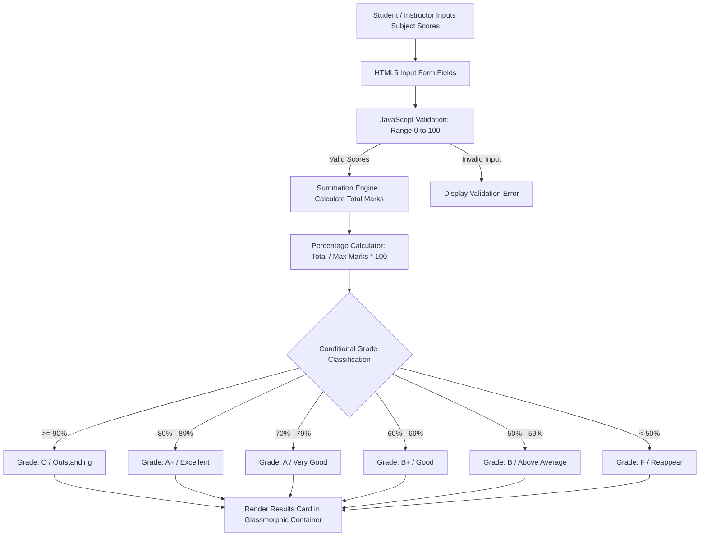

<div align="center">


[](https://developer.mozilla.org/en-US/docs/Web/HTML)
[](https://developer.mozilla.org/en-US/docs/Web/CSS)
[](https://developer.mozilla.org/en-US/docs/Web/JavaScript)
[](#)
[](#)
[](#)

</div>

---

## 📌 Executive Summary / Overview

The **Student's Marks Grading System** (`FSD_PothamchettyJeswanthika`) is a full-stack educational web application and academic mini-project developed for Bachelor of Computer Applications (Honors), Semester IV, at the Department of Computer Applications, Alliance University.

The project pairs an interactive web grading calculator with formal engineering documentation (`STUDENT'S MARKS GRADING SYSTEM REPORT 2.docx`). Built with an ultra-modern glassmorphism visual interface (`backdrop-filter: blur(12px)`), the application computes aggregate student marks, percentage distributions, letter grades, and academic performance tierings with real-time client-side JavaScript validation.

---

## 📖 Interactive Table of Contents

- [Executive Summary / Overview](#-executive-summary--overview)
- [Key Features & Capabilities](#-key-features--capabilities)
- [System Architecture & Grading Logic](#-system-architecture--grading-logic)
- [Tech Stack Breakdown](#-tech-stack-breakdown)
- [Academic Grading Scale Criteria](#-academic-grading-scale-criteria)
- [Reproducible Quickstart & Setup](#-reproducible-quickstart--setup)
- [Project Directory Layout](#-project-directory-layout)
- [Author & Academic Attribution](#-author--academic-attribution)

---

## ✨ Key Features & Capabilities

- **Glassmorphic Card UI**: Translucent glass-textured container with frosted blur styling, smooth rounded borders, and subtle box shadows.
- **Dynamic Grade & Percentage Calculator**: Instant calculation of total marks, percentage, and letter grade classifications upon form submission.
- **Multi-Subject Mark Ingestion**: Intuitive input fields accepting individual subject assessments (Theory, Practical, Internal, External).
- **Client-Side Boundary Validation**: Prevents invalid numerical ranges ($< 0$ or $> 100$) and alerts users to non-numeric inputs.
- **Academic Technical Report Included**: Complete project documentation detailing project scope, input/output schemas, test matrices, and source code.

---

## 🏗️ System Architecture & Grading Logic



---

## 🛠️ Tech Stack Breakdown

| Category | Technologies & Tools |
| :--- | :--- |
| **Frontend Markup** | HTML5 (Semantic Structure, Accessible Input Controls) |
| **Visual Styling** | CSS3 (Glassmorphism, Backdrop Blur, Linear Gradients, Flexbox) |
| **Scripting Engine** | Vanilla JavaScript (ES6+, Event Listeners, DOM Manipulation) |
| **Documentation** | Microsoft Word DOCX (Full Project Report with Diagrams) |

---

## 🎓 Academic Grading Scale Criteria

| Percentage Range | Letter Grade | Performance Classification | Status |
| :--- | :--- | :--- | :--- |
| **90% – 100%** | **O** | Outstanding | Distinction |
| **80% – 89%** | **A+** | Excellent | First Class with Distinction |
| **70% – 79%** | **A** | Very Good | First Class |
| **60% – 69%** | **B+** | Good | Higher Second Class |
| **50% – 59%** | **B** | Above Average | Second Class |
| **40% – 49%** | **C** | Pass | Pass Division |
| **Below 40%** | **F** | Fail / Reappear | Unsatisfactory |

---

## 🚀 Reproducible Quickstart & Setup

### Prerequisites
- Modern web browser (Chrome, Edge, Firefox, Safari)
- Microsoft Word or compatible reader for `.docx` documentation

### Step 1: Clone the Repository
```bash
git clone https://github.com/Jeshwanthika07/FSD_PothamchettyJeswanthika.git
cd FSD_PothamchettyJeswanthika
```

### Step 2: Access the Project Report
Open `STUDENT'S MARKS GRADING SYSTEM REPORT 2.docx` in Microsoft Word to inspect the complete project blueprint, screenshots, and full source code.

---

## 📂 Project Directory Layout

```text
FSD_PothamchettyJeswanthika/
│
├── STUDENT'S MARKS GRADING SYSTEM REPORT 2.docx  # Full Semester IV academic report
└── README.md                                    # Comprehensive system documentation
```

---

## 👩‍💻 Author & Academic Attribution

**Jeshwanthika Pothamchetty** (Reg No: 2411021240015)  
*Co-Author*: Baineni Varun Tej (Reg No: 2411021240073)  
*Faculty Guide*: Prof. Veera Raghav K  
*Department of Computer Applications, Alliance University, Bengaluru*

<div align="center">


</div>
